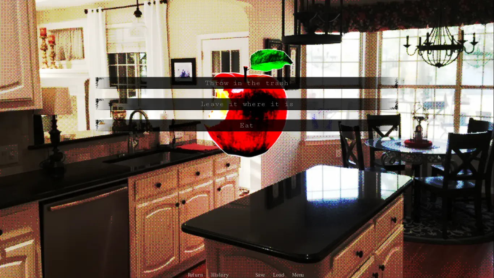

# Home Is Where He Is

[Visit Home Is Where He Is](https://homeiswhereheis.net/)

## Explore the Website

Home Is Where He Is turns a familiar phrase into a horror hook. The game keeps its scope tight, then lets the idea of home become watchful, private, and strangely claimed before the player fully understands the room.

Desktop or laptop play is recommended. The embedded game may load on some mobile browsers, but a larger screen and keyboard input usually make short horror games easier to read and control.

Use the videos as a preview, a comparison point, or a post-run reference once the browser game has had a chance to land on its own.

Home Is Where He Is is a compact browser horror game about a familiar place becoming difficult to trust. The title sounds comforting at first, but the game turns that phrase into something colder: home may be where he is, yet that does not mean home is safe for you.

This page is designed as a fast, game-first hub. Players can launch Home Is Where He Is online in the embedded frame, watch the available gameplay videos, read spoiler-light context, and check practical browser help without moving through several pages.

The game works because it keeps the scope tight. Short horror often becomes stronger when it focuses on one idea and lets the player sit with it. Here, the idea of home becomes watchful, private, and strangely claimed before the player fully understands the rules of the space.

Press Play in the main frame to load the game. If the frame stays black for a few seconds, wait before refreshing because browser games hosted on a remote static domain can take a moment to fetch their files.

If the game still does not load, open the direct game link in a new tab from the control strip. Privacy extensions, iframe blockers, strict browser settings, or network filters can prevent the embedded player from loading even when the game source itself is healthy.

Play slowly on your first run. Home Is Where He Is is built around mood and tension, so rushing can flatten the parts that make the short experience memorable.

The videos are useful after a run, or before playing if you prefer checking tone first. For the strongest first impression, start with the browser build, then return to the guide and FAQ if you want to compare notes.

Yes. Press Play in the main game frame and Home Is Where He Is will load directly in your browser through the embedded online build.

## Plan Your Visit

It is a short indie browser horror game with a psychological tone. The game uses the idea of home, presence, and unease to create tension.

Desktop or laptop play is recommended. The embedded frame, screen readability, and browser controls are usually more reliable on a larger display.

Wait a moment, refresh once, then try the direct game link if the iframe still stays blank. Browser extensions that block scripts or iframes can also cause loading issues.

You can, but the best first experience is usually to play before watching a full run. The videos are included for players who want a preview or post-run reference.

It is a horror game, so it is best for players who are comfortable with unsettling themes, tension, and dark atmosphere.

The page is built around immediate play. The large frame lets players start quickly, then scroll for videos, screenshots, guide sections, and FAQ help afterward.

## A spoiler-light first visit

This is a page for people who want to experience the game before reading an explanation of it. Start with the player if you already know that short psychological horror is what you want. If you are unsure about the tone, use a screenshot or a brief video preview first. These are different ways to approach the same visit, not tasks that must all be completed. Stop whenever the atmosphere is no longer enjoyable.

A compact horror experience benefits from attention rather than speed. Notice how the setting changes your expectations and give yourself time to read what the game presents. You do not need to chase a perfect run or look for a hidden checklist in this introduction. The website's role is to make the game and its surrounding references easy to reach, not to promise a particular ending, a fixed completion time or features that are not described by the game itself.

## Returning for help

When you return to the page, distinguish a problem with the surrounding website from a problem inside the game. If the page is readable but the player is blank, the embedded experience may still be loading or may be blocked. If the game appears but does not react, check that it has focus before assuming your progress is lost. Avoid repeatedly refreshing an active session merely because an instruction takes a moment to understand.

The pictures below are existing artwork and game images used by this website. They help establish the presentation without replacing your own first impression. Videos can reveal more of the experience, so choose when to watch them according to your spoiler preference. Related games offer another direction after this one, but each title has its own controls, content and device requirements. A familiar page layout does not mean that every embedded game behaves the same way.

## Visit Online

[Open Home Is Where He Is](https://homeiswhereheis.net/) to explore the website and choose your next activity.
